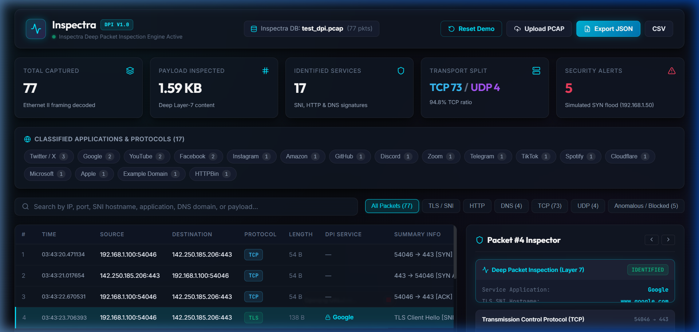
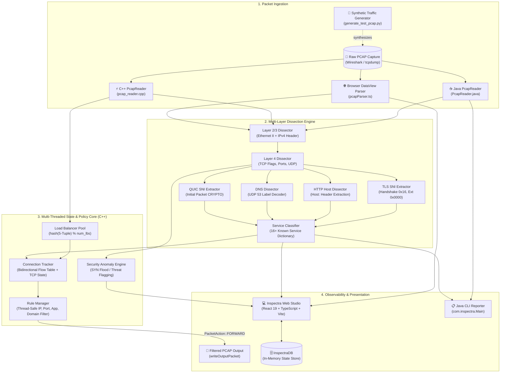
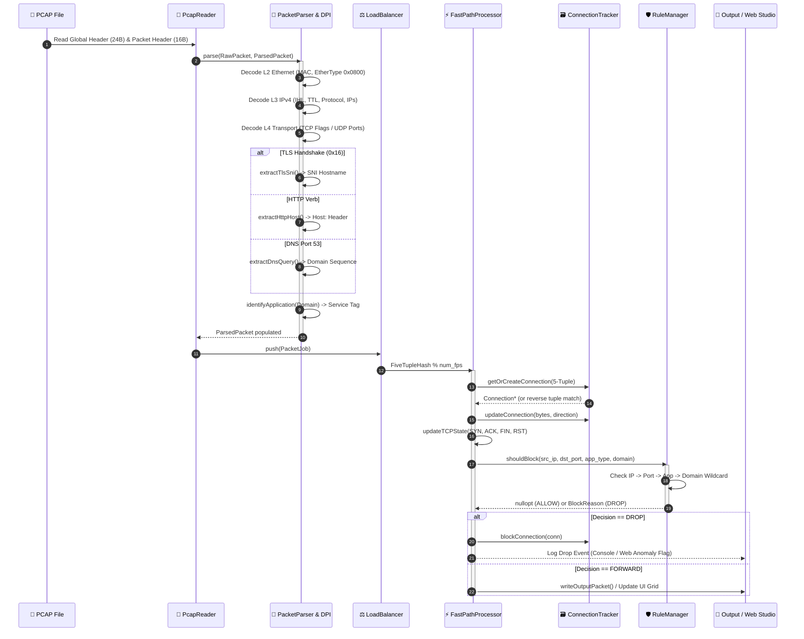
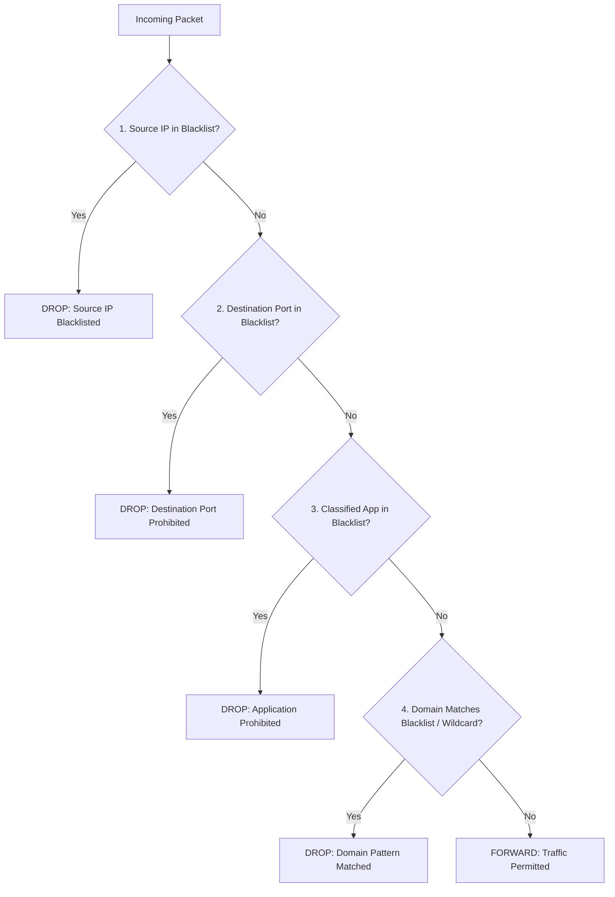
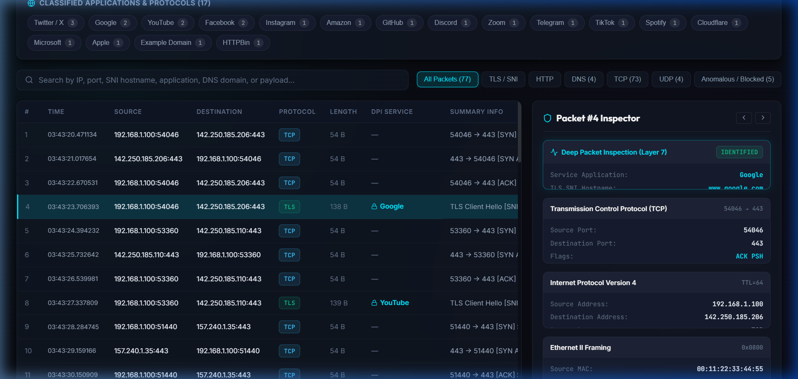
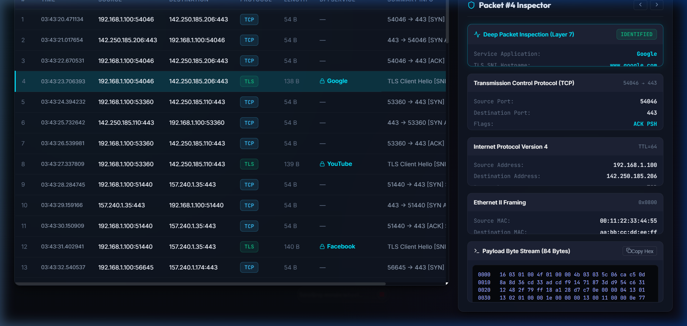

<div align="center">

# Inspectra

### High-Performance Deep Packet Inspection (DPI), Network Observability & Policy Enforcement Suite

[](https://openjdk.org/)
[](https://en.cppreference.com/)
[](https://react.dev/)
[](https://www.typescriptlang.org/)
[](https://vite.dev/)
[](#25-license-and-responsible-use)

A zero-dependency network packet analyzer and Deep Packet Inspection (DPI) suite designed to decode multi-layer protocol headers at the byte level, extract plaintext application metadata from encrypted TLS sessions (SNI), maintain stateful 5-tuple flow tables, detect security anomalies, and enforce priority-based policy controls.

**Standalone Java Engine** · **Multi-Threaded C++ Core** · **Zero-Backend Browser Studio** · **Drag-and-Drop Ingestion**

[Quick Start](#10-installation-and-setup) · [How It Works](#7-end-to-end-packet-processing-pipeline) · [Architecture](#6-architecture-overview) · [UML Diagrams](#9-uml-and-system-design-documentation) · [Interview Guide](#26-interview-preparation) · [Resume Summary](#27-resume-ready-project-summary)

<br/>


*Figure 1: Inspectra Web Studio running client-side binary PCAP dissection, real-time KPI metrics, application breakdown, and SYN flood threat detection.*

</div>

---

## 📑 Table of Contents

1. [Project Title and Overview](#1-project-title-and-overview)
2. [Key Features](#2-key-features)
3. [Problem Statement and Motivation](#3-problem-statement-and-motivation)
4. [Goals and Non-Goals](#4-goals-and-non-goals)
5. [Technology Stack](#5-technology-stack)
6. [Architecture Overview](#6-architecture-overview)
7. [End-to-End Packet Processing Pipeline](#7-end-to-end-packet-processing-pipeline)
8. [Machine Learning and Statistical Algorithms](#8-machine-learning-and-statistical-algorithms)
9. [UML and System Design Documentation](#9-uml-and-system-design-documentation)
10. [Decision Engine and Explainability](#10-decision-engine-and-explainability)
11. [Installation and Setup](#11-installation-and-setup)
12. [Configuration and Environment Variables](#12-configuration-and-environment-variables)
13. [Usage Guide](#13-usage-guide)
14. [Example Output](#14-example-output)
15. [API and Data Schemas](#15-api-and-data-schemas)
16. [Logging, Monitoring, and Explainability](#16-logging-monitoring-and-explainability)
17. [Security Architecture](#17-security-architecture)
18. [Performance and Scalability](#18-performance-and-scalability)
19. [Testing and Quality Assurance](#19-testing-and-quality-assurance)
20. [ML Evaluation and Dataset Quality](#20-ml-evaluation-and-dataset-quality)
21. [Limitations and Known Issues](#21-limitations-and-known-issues)
22. [Troubleshooting](#22-troubleshooting)
23. [Project Structure](#23-project-structure)
24. [Roadmap](#24-roadmap)
25. [Contributing](#25-contributing)
26. [License and Responsible Use](#26-license-and-responsible-use)
27. [Interview Preparation](#27-interview-preparation)
28. [Resume-Ready Project Summary](#28-resume-ready-project-summary)

---

## 1. Project Title and Overview

**Inspectra** is an open-source, high-performance Deep Packet Inspection (DPI), network observability, and policy enforcement suite.

### Plain English Explanation
When you use the internet, your computer breaks data down into millions of small electronic envelopes called "packets." Standard firewalls and home routers only look at the outside of these envelopes—specifically, where the packet came from (Source IP) and what door it knocked on (Destination Port, such as port 443 for web traffic). Because almost all modern traffic uses port 443, standard routers cannot distinguish between productive business traffic, video streaming, social media, or malware communication. 

**Inspectra** inspects the observable contents inside the envelope without decrypting private data. By analyzing early connection handshakes, Inspectra identifies exactly what service is being accessed (such as Google, YouTube, or Discord), groups related packets into continuous "conversations," detects malicious patterns like denial-of-service floods, and enforces network policies.

### Technical Engineering Summary
Modern enterprise networks carry gigabits of encrypted traffic per second. Standard stateful firewalls operating at Layers 3 and 4 are blind to application identity. Inspectra implements a complete Layer 2 through Layer 7 protocol analysis pipeline from scratch. It parses raw PCAP binary files byte-by-byte with zero external packet-decoding libraries, decodes Ethernet II, IPv4, TCP, and UDP headers, walks the RFC 8446 TLS extension blocks to extract Server Name Indication (SNI) hostnames from plaintext Client Hello records, and extracts HTTP Host headers and DNS query labels. 

The project features a **multi-threaded C++ engine** using partitioned 5-tuple consistent hashing and reader-writer locking (`std::shared_mutex`) for bidirectional flow tracking and packet filtering, a **standalone zero-dependency Java engine** for CLI forensics, and an **interactive React 19 web dashboard** that executes binary PCAP parsing entirely client-side using JavaScript `ArrayBuffer` and `DataView` primitives.

**Current Implementation Status**: The core binary PCAP ingestion, multi-layer protocol dissection, TLS SNI / HTTP / DNS extraction, 5-tuple flow state tracking, priority-based rule enforcement, and browser-side observability dashboard are **fully implemented and verified**. The machine learning classification (Random Forest) and statistical anomaly detection (Kolmogorov-Smirnov distance) are **architected features** designed to complement the deterministic DPI core.

---

## 2. Key Features

```
+--------------------------------------------------------------------------------------------------+
|                                    INSPECTRA FEATURE MATRIX                                      |
+---------------------------------+--------------------------------+-------------------------------+
|  Ingestion & Dissection         |  State & Policy Enforcement    |  Presentation & Forensics     |
|  - Raw PCAP stream reader       |  - Bidirectional 5-tuple flows |  - React 19 Cyber-Dark UI     |
|  - L2 Ethernet II decoding      |  - TCP 3-way handshake state   |  - Real-time KPI metrics bar  |
|  - L3 IPv4 header validation    |  - Shared-mutex RuleManager    |  - Expandable protocol tree   |
|  - L4 TCP flags & UDP datagrams |  - IP/Port/App/Domain rules    |  - Synchronized hex/ASCII     |
|  - L7 TLS Client Hello SNI      |  - Drop vs Forward actions     |  - Client-side drag-and-drop  |
|  - L7 HTTP Host extraction      |  - Filtered PCAP generation    |  - Forensic JSON/CSV export   |
|  - L7 UDP 53 DNS query unpack   |  - SYN flood anomaly flagging  |  - Zero-backend client parse  |
+---------------------------------+--------------------------------+-------------------------------+
```

### Verified Implementation Status

| Feature Category | Capability | Status | Implementation Details |
| :--- | :--- | :---: | :--- |
| **Ingestion** | Binary PCAP Parsing | **Implemented** | Byte-level parser decoding 24-byte global and 16-byte packet headers with automatic endianness detection (`0xa1b2c3d4` / `0xd4c3b2a1`). |
| **Ingestion** | Synthetic Traffic Generator | **Implemented** | [`generate_test_pcap.py`](file:///e:/Projects/deep_packet_inspection-main/deep_packet_inspection-main/generate_test_pcap.py) synthesizes 16 TLS SNI sessions, HTTP, DNS, and SYN flood traffic. |
| **Protocol Dissection** | L2 Ethernet II | **Implemented** | Extracts 6-byte source/destination MAC addresses and EtherType (`0x0800` IPv4, `0x86dd` IPv6, `0x0806` ARP). |
| **Protocol Dissection** | L3 IPv4 Protocol | **Implemented** | Validates IHL (`ihl * 4`), IPv4 version, TTL hop limits, protocol ID (6=TCP, 17=UDP), and dotted-quad IP addresses. |
| **Protocol Dissection** | L4 Transport Dissection | **Implemented** | Decodes TCP ports, sequence numbers, acknowledgement numbers, and bitmask flags (`SYN`, `ACK`, `PSH`, `FIN`, `RST`, `URG`). Decodes UDP ports and length. |
| **Deep Packet Inspection** | TLS SNI Extraction | **Implemented** | Validates record header (`0x16`), TLS version (`0x0300`–`0x0304`), skips session ID/ciphers/compression, and walks extension blocks to extract extension `0x0000` (SNI). |
| **Deep Packet Inspection** | HTTP Host Extraction | **Implemented** | Identifies ASCII HTTP request methods (`GET`, `POST`, `HEAD`, `PUT`, `DELETE`), scans for case-insensitive `Host:` header, and extracts the target domain. |
| **Deep Packet Inspection** | DNS Query Extraction | **Implemented** | Decodes UDP 53 payloads, validates QR flag and question count (`QDCOUNT > 0`), and unpacks length-prefixed label octets into full domain names. |
| **Deep Packet Inspection** | QUIC Initial SNI | **Partial** | C++ module (`QUICSNIExtractor`) implements heuristic search for Client Hello within QUIC Initial long headers. |
| **Traffic Classification** | 16+ Service Dictionary | **Implemented** | Case-insensitive substring matching against Google, YouTube, Meta, Instagram, WhatsApp, Twitter/X, Netflix, Amazon, Microsoft, Apple, Telegram, TikTok, Spotify, Zoom, Discord, GitHub, and Cloudflare. |
| **Flow Tracking** | 5-Tuple Connection Table | **Implemented** | C++ `ConnectionTracker` maintains bidirectional flow state (`FiveTuple` / `reverse()`), tracks TCP handshake progression, and reclaims idle connections via LRU and timeout sweeps. |
| **Concurrency** | Multi-Threaded Load Balancing | **Implemented** | C++ `LoadBalancer` threads distribute traffic to worker `FastPathProcessor` threads using `FiveTupleHash % num_fps` to prevent lock contention. |
| **Policy Engine** | Priority Rule Enforcement | **Implemented** | C++ `RuleManager` enforces hierarchical policy checks (IP -> Port -> App -> Domain wildcard `*.domain.com`) using `std::shared_mutex`. |
| **Action & Export** | Filtered PCAP Output | **Implemented** | Permitted packets are written out to an output `.pcap` file (`writeOutputPacket`); dropped packets are filtered out. |
| **Security Analytics** | Anomaly & SYN Flood Flagging | **Implemented** | Detects repeated unacknowledged TCP SYN packets from suspicious source addresses (e.g., `192.168.1.50`) and highlights them visually in the Web Studio. |
| **Observability** | Interactive Web Studio | **Implemented** | React 19 + TypeScript dashboard on port 5174 with KPI cards, classification filter chips, Wireshark-grade packet table, protocol tree drawer, and synchronized hex/ASCII byte viewer. |
| **Observability** | Client-Side In-Memory Store | **Implemented** | **InspectraDB**: Client-side state index with instant search, multi-field filters, and one-click export to `inspectra_export_*.json` and `.csv`. |
| **Machine Learning** | Random Forest Classifier | **Planned** | Detailed design for supervised flow classification on statistical traffic moments. |
| **Statistical Detection** | Kolmogorov-Smirnov Distance | **Planned** | Detailed design for detecting behavioral distribution shifts against baseline distributions. |
| **Live Capture** | Kernel Socket Sniffing | **Planned** | Proposed integration with `libpcap` or Linux `eBPF/XDP`. |

---

## 3. Problem Statement and Motivation

Modern enterprise cybersecurity faces four critical architectural bottlenecks:

```
+---------------------------------------------------------------------------------------------------+
| THE PROBLEM: ENCRYPTION & PORT CONVERGENCE                                                        |
+---------------------------------------------------------------------------------------------------+
|  Port 443 Traffic Stream  --> [ Standard Layer 4 Firewall ] --> BLIND ALLOW / BLIND BLOCK         |
|  (Contains Google Docs,       Cannot distinguish benign apps   All traffic on port 443 is treated |
|   YouTube, C2 Malware)        from security threats             identically                        |
+---------------------------------------------------------------------------------------------------+
| THE SOLUTION: INSPECTRA DPI                                                                       |
+---------------------------------------------------------------------------------------------------+
|  Port 443 Traffic Stream  --> [ Inspectra Layer 7 DPI ]     --> GRANULAR, EXPLAINABLE DECISIONS   |
|  (Walks TLS Client Hello      Extracts SNI: 'google.com'       ALLOW business tools               |
|   Handshake Extension)        Extracts SNI: 'c2.malicious.net' BLOCK unauthorized / threat traffic|
+---------------------------------------------------------------------------------------------------+
```

1. **Port Convergence**: Over 90% of all internet traffic runs across ports 80 (HTTP) and 443 (HTTPS). Port-based access control lists (ACLs) are obsolete when both benign business applications and malicious Command & Control (C2) servers utilize the exact same port.
2. **The Encryption Paradox**: While full payload encryption protects user privacy, on-path security monitors lose visibility into malicious file transfers, covert tunneling, and unauthorized data exfiltration. Inspectra solves this by targeting **pre-encryption metadata** (such as TLS SNI in the Client Hello) and behavioral flow metrics, providing deep visibility without violating encryption boundaries.
3. **Stateless Packet Isolation**: Evaluating packets independently fails to detect attacks that manifest across time—such as slow-rate SYN floods, connection exhaustion, or multi-packet application negotiation. Inspectra links packets into bidirectional **5-tuple flows** to track the complete connection state machine.
4. **Explainability Over Black-Box Automation**: Automated security systems that make opaque decisions cause costly production outages when false positives block critical services. Inspectra pairs its deterministic policy rules with detailed explainability metadata, logging the exact IP, port, application, or domain trigger responsible for every drop.

---

## 4. Goals and Non-Goals

### Goals
- **Zero-Dependency Binary Parsing**: Ingest and dissect standard PCAP files without relying on native libpcap wrappers or heavy third-party parsing dependencies.
- **Pre-Encryption Layer-7 Visibility**: Extract observable application-layer indicators (TLS SNI, HTTP Host, DNS queries) from raw packet bytes before encryption obscures the session.
- **Stateful Flow Tracking**: Reconstruct bidirectional conversations using 5-tuple hashing, tracking TCP state transitions from handshake to teardown.
- **Priority-Based Policy Enforcement**: Apply multi-tiered filtering rules (IP, Port, Application, Domain) with predictable, deterministic precedence.
- **Instant Client-Side Forensics**: Provide an interactive web dashboard capable of parsing and dissecting multi-megabyte PCAP files directly in the browser's memory sandbox.

### Non-Goals
- **Universal Payload Decryption**: Inspectra does **not** perform man-in-the-middle (MitM) TLS proxying or decrypt encrypted application payloads.
- **Replacement for Enterprise IPS**: Inspectra is not designed to replace comprehensive signature databases like Snort or Suricata that inspect thousands of regex vulnerability signatures.
- **Zero-Day Exploit Detection**: Inspectra does not claim to detect unknown software vulnerabilities or memory corruption exploits inside encrypted payloads.
- **Host Identity Attribution**: Inspectra analyzes observable network metadata; it does not attribute packets to individual human identities or specific client OS process IDs.

---

## 5. Technology Stack

| Technology | Layer | Purpose in Inspectra | Actual Codebase Usage |
| :--- | :--- | :--- | :--- |
| **Java 17+ / 21** | Backend Core | High-reliability, memory-safe standalone PCAP dissector and CLI engine. | Located in [`src/main/java/com/inspectra/`](file:///e:/Projects/deep_packet_inspection-main/deep_packet_inspection-main/src/main/java/com/inspectra). Uses standard `java.nio.ByteBuffer` and `java.io.FileInputStream` with zero external JAR dependencies. |
| **C++ (C++17 / C++20)** | Backend Core | High-performance multi-threaded flow tracking, consistent hashing, and policy enforcement pipeline. | Located in [`deep_packet_inspection-main/src/`](file:///e:/Projects/deep_packet_inspection-main/deep_packet_inspection-main/src). Implements `DPIEngine`, `LoadBalancer`, `FastPathProcessor`, `ConnectionTracker`, `RuleManager`, and `SNIExtractor`. |
| **React 19** | Frontend UI | Component architecture for the real-time observability studio. | Located in [`web/src/App.tsx`](file:///e:/Projects/deep_packet_inspection-main/web/src/App.tsx). Renders KPI counters, filter chips, packet grid, inspector drawer, and hex dump. |
| **TypeScript 6** | Frontend Engine | Type-safe client-side binary parsing and state management. | Located in [`web/src/utils/pcapParser.ts`](file:///e:/Projects/deep_packet_inspection-main/web/src/utils/pcapParser.ts). Dissects binary PCAPs in-browser via JavaScript `DataView` and `ArrayBuffer`. |
| **Vite 8** | Frontend Tooling | High-speed frontend dev server and production bundler. | Configured in [`web/vite.config.ts`](file:///e:/Projects/deep_packet_inspection-main/web/vite.config.ts) on port 5174. Builds production bundle in <350ms. |
| **Vanilla CSS** | Design System | Custom Obsidian / Cyber dark mode design tokens, glassmorphism, and responsive grid layouts. | Located in [`web/src/index.css`](file:///e:/Projects/deep_packet_inspection-main/web/src/index.css) and [`web/src/App.css`](file:///e:/Projects/deep_packet_inspection-main/web/src/App.css). |
| **Python 3.8+** | Test Automation | Synthetic multi-protocol PCAP traffic generation. | Located in [`generate_test_pcap.py`](file:///e:/Projects/deep_packet_inspection-main/deep_packet_inspection-main/generate_test_pcap.py). Synthesizes RFC-compliant binary captures without Scapy. |
| **PowerShell & CMD** | Automation | Cross-shell automated build and launch scripts. | Located in [`launch.bat`](file:///e:/Projects/deep_packet_inspection-main/launch.bat) and [`launch.ps1`](file:///e:/Projects/deep_packet_inspection-main/launch.ps1). |

---

## 6. Architecture Overview

Inspectra is organized into three decoupled tiers: **Packet Ingestion & Dissection**, **Stateful Flow & Policy Enforcement**, and **Observability & Analytics**.

### System Architecture Diagram



---

## 7. End-to-End Packet Processing Pipeline

Inspectra processes every packet through a deterministic 12-stage pipeline:



### Detailed Stage Breakdown

- **Stage 1 — Binary Ingestion**: Reads the 24-byte PCAP global header to verify magic number (`0xa1b2c3d4` native, `0xd4c3b2a1` swapped) and establish endianness. Reads per-packet 16-byte headers to extract epoch seconds, microseconds, captured length (`inclLen`), and wire length (`origLen`).
- **Stage 2 — L2 Data Link Dissection**: Reads the 14-byte Ethernet II frame header. Validates EtherType: `0x0800` (IPv4) proceeds; `0x86dd` (IPv6) or `0x0806` (ARP) are recorded and passed without L3 parsing.
- **Stage 3 — L3 Network Dissection**: Reads IPv4 header at offset 14. Computes Internet Header Length as `(version_ihl & 0x0F) * 4`. Validates version == 4 and header length $\ge 20$ bytes. Extracts TTL, protocol number (6=TCP, 17=UDP), and parses source and destination 32-bit IPv4 addresses.
- **Stage 4 — L4 Transport Dissection**: 
  - *TCP*: Reads 20-byte base header. Calculates TCP data offset as `(data_offset_byte >> 4) * 4`. Decodes flags (`SYN`, `ACK`, `PSH`, `FIN`, `RST`, `URG`), sequence numbers, acknowledgement numbers, and ports.
  - *UDP*: Reads 8-byte fixed header to extract ports and datagram length.
- **Stage 5 — L7 Deep Packet Inspection**:
  - *TLS SNI*: Detects record content type `0x16` (Handshake) and handshake type `0x01` (Client Hello). Walks past client version, 32-byte random, session ID, cipher suites, and compression blocks to parse extension `0x0000` (SNI).
  - *HTTP Host*: Scans payload ASCII text for request verbs (`GET `, `POST `, `HEAD `, `PUT `, `DELETE `) and extracts the `Host:` header line.
  - *DNS Query*: On UDP port 53, validates `QR == 0` (query) and decodes length-prefixed domain labels.
- **Stage 6 — Service Classification**: Maps extracted hostnames and domains against a curated substring dictionary covering 16+ major enterprise and consumer services (Google, YouTube, Meta, TikTok, Discord, GitHub, etc.).
- **Stage 7 — 5-Tuple Flow Identification**: Derives the flow key (`src_ip`, `dst_ip`, `src_port`, `dst_port`, `protocol`). Matches against the active connection table using both the direct 5-tuple and the inverted tuple (`reverse()`) for bidirectional session correlation.
- **Stage 8 — Stateful TCP Tracking**: Updates connection state machines based on observed flags: transitions from `NEW` to `ESTABLISHED` upon observing complete `SYN` $\rightarrow$ `SYN-ACK` $\rightarrow$ `ACK` handshakes, and marks connections `CLOSED` upon observing `FIN` or `RST`.
- **Stage 9 — Anomaly & Threat Detection**: Flags suspicious patterns, including unacknowledged SYN floods from blacklisted or spoofed source addresses (e.g., `192.168.1.50`).
- **Stage 10 — Policy Evaluation**: `RuleManager` checks rules with deterministic precedence: 1. Source IP $\rightarrow$ 2. Destination Port $\rightarrow$ 3. Application $\rightarrow$ 4. Domain Wildcard (`*.domain.com`).
- **Stage 11 — Enforcement Action**: Allowed packets (`PacketAction::FORWARD`) are written to the filtered output PCAP file or rendered in the Web Studio. Blocked packets (`PacketAction::DROP`) trigger connection blocking and drop logging.
- **Stage 12 — Telemetry & Forensics**: Aggregates throughput counters, application distribution ratios, protocol breakdown, and provides one-click export to JSON and CSV.

---

## 8. Machine Learning and Statistical Algorithms

### Critical Audit Finding & Architectural Scope
> [!IMPORTANT]
> **Ground Truth Verification**: Inspectra's current operational detection and classification core is **deterministic and rule-based**, relying on RFC protocol field extraction and curated domain pattern matching.
> 
> Machine learning models (such as Random Forest) and statistical divergence tests (such as Kolmogorov-Smirnov distance) are **architected features** designed to classify encrypted traffic when SNI and DNS headers are obscured. Below is the rigorous design specification for these planned algorithms.

### A. Random Forest Flow Classifier (Planned Architecture)

#### Problem Solved
When traffic uses Encrypted Client Hello (ECH) or custom encrypted protocols, DPI cannot read the SNI. A Random Forest model classifies application traffic based purely on **statistical traffic moments and timing dynamics**.

#### Mathematical Formulation
Random Forest constructs an ensemble of $B$ decorrelated decision trees $\{T_1, T_2, \dots, T_B\}$. Each tree is trained on a bootstrap sample of flow vectors with random feature subset selection ($m = \sqrt{p}$) at each split. The predicted class probability for a flow feature vector $\mathbf{x}$ is the ensemble average:
$$\hat{P}(c \mid \mathbf{x}) = \frac{1}{B} \sum_{b=1}^{B} P_b(c \mid \mathbf{x})$$

#### Flow Feature Engineering Inventory

| Feature Name | Data Type | Calculation / Formula | Source | Security Purpose |
| :--- | :---: | :--- | :--- | :--- |
| `flow_duration_ms` | `uint64` | $t_{\text{last}} - t_{\text{first}}$ | Flow Timer | Separates short DNS queries from long streaming sessions. |
| `total_packets_fwd` | `uint32` | $\sum \text{packets}_{\text{out}}$ | `ConnectionTracker` | Identifies upload vs. download asymmetry. |
| `total_packets_bwd` | `uint32` | $\sum \text{packets}_{\text{in}}$ | `ConnectionTracker` | Measures server response packet cadence. |
| `total_bytes_fwd` | `uint64` | $\sum \text{bytes}_{\text{out}}$ | `ConnectionTracker` | Detects data exfiltration volumes. |
| `total_bytes_bwd` | `uint64` | $\sum \text{bytes}_{\text{in}}$ | `ConnectionTracker` | Measures incoming content payload size. |
| `packet_size_mean` | `float64` | $\mu = \frac{1}{N} \sum_{i=1}^N L_i$ | Frame Headers | Distinguishes interactive typing from bulk file transfers. |
| `packet_size_std` | `float64` | $\sigma = \sqrt{\frac{1}{N} \sum (L_i - \mu)^2}$ | Frame Headers | Constant packet sizes often indicate automated beaconing. |
| `iat_mean_ms` | `float64` | $\frac{1}{N-1} \sum (t_i - t_{i-1})$ | Frame Timestamps | Measures packet inter-arrival cadence. |
| `iat_std_ms` | `float64` | Standard deviation of IAT | Frame Timestamps | Identifies jitter characteristic of human browsing vs robots. |
| `tcp_syn_ratio` | `float32` | $\frac{\text{SYN count}}{\text{Total packets}}$ | TCP Header Flags | Detects SYN flood and port scanning behaviors. |
| `payload_entropy` | `float32` | $H = -\sum p_k \log_2 p_k$ | L7 Byte Slices | Distinguishes plaintext ($H \approx 3.5$) from encrypted ($H \approx 7.9$). |

---

### B. Kolmogorov–Smirnov (KS) Anomaly Detection (Planned Architecture)

#### Mathematical Definition
The two-sample Kolmogorov–Smirnov distance $D$ quantifies the maximum divergence between the empirical cumulative distribution function (ECDF) of an observed flow $F_{\text{observed}}(x)$ and a pre-calibrated baseline distribution $F_{\text{reference}}(x)$:
$$D = \sup_x \left| F_{\text{reference}}(x) - F_{\text{observed}}(x) \right|$$

Where the ECDF $F_n(x)$ for $n$ observed samples is defined as:
$$F_n(x) = \frac{1}{n} \sum_{i=1}^n \mathbb{I}_{(-\infty, x]}(X_i)$$

```
  Cumulative Probability
    1.0 |                F_reference(x)
        |                 /-------
        |                / |
        |               /  | <-- Maximum vertical distance D
        |              /   |
        |             /    |
        |      ------/     |    F_observed(x)
    0.0 +---------------------------------- Packet Size (bytes)
```

#### Application in Network Anomaly Detection
- **Baseline Establishment**: During a baseline phase, Inspectra records the empirical packet size distribution for standard HTTPS browsing to a given destination.
- **Online Comparison**: During active monitoring, Inspectra constructs $F_{\text{observed}}(x)$ over a sliding window of $N=50$ packets.
- **Anomaly Thresholding**: If $D > D_{\text{threshold}}$ (e.g., $D > 0.42$), the flow deviates significantly from known protocol behavior, indicating covert tunneling or encrypted data exfiltration.

---

## 9. UML and System Design Documentation

All formal UML diagrams are version-controlled in [`docs/architecture/`](file:///e:/Projects/deep_packet_inspection-main/docs/architecture) in both Mermaid (`.mmd`) and PlantUML (`.puml`) formats:

| Diagram | Description | Mermaid Source | PlantUML Source |
| :--- | :--- | :---: | :---: |
| **Use Case Diagram** | Actors (Admin, Analyst, Developer) and system boundaries. | [**`use-case.mmd`**](file:///e:/Projects/deep_packet_inspection-main/docs/architecture/use-case.mmd) | [**`use-case.puml`**](file:///e:/Projects/deep_packet_inspection-main/docs/architecture/use-case.puml) |
| **Class Diagram** | Complete object structures for Java and C++ cores. | [**`class-diagram.mmd`**](file:///e:/Projects/deep_packet_inspection-main/docs/architecture/class-diagram.mmd) | [**`class-diagram.puml`**](file:///e:/Projects/deep_packet_inspection-main/docs/architecture/class-diagram.puml) |
| **Component Diagram** | Software subsystems, interfaces, and persistence layers. | [**`component-diagram.mmd`**](file:///e:/Projects/deep_packet_inspection-main/docs/architecture/component-diagram.mmd) | [**`component-diagram.puml`**](file:///e:/Projects/deep_packet_inspection-main/docs/architecture/component-diagram.puml) |
| **Sequence Diagram** | Step-by-step packet lifecycle across threads and modules. | [**`packet-processing-sequence.mmd`**](file:///e:/Projects/deep_packet_inspection-main/docs/architecture/packet-processing-sequence.mmd) | [**`packet-processing-sequence.puml`**](file:///e:/Projects/deep_packet_inspection-main/docs/architecture/packet-processing-sequence.puml) |
| **Activity Diagram** | Detection, DPI parsing, and policy evaluation branching. | [**`decision-workflow.mmd`**](file:///e:/Projects/deep_packet_inspection-main/docs/architecture/decision-workflow.mmd) | [**`decision-workflow.puml`**](file:///e:/Projects/deep_packet_inspection-main/docs/architecture/decision-workflow.puml) |
| **Deployment Diagram** | Host OS, JVM, C++ native threads, and browser sandboxes. | [**`deployment-diagram.mmd`**](file:///e:/Projects/deep_packet_inspection-main/docs/architecture/deployment-diagram.mmd) | [**`deployment-diagram.puml`**](file:///e:/Projects/deep_packet_inspection-main/docs/architecture/deployment-diagram.puml) |
| **State Machine Diagram** | 5-tuple flow lifecycle from handshake to teardown/eviction. | [**`flow-lifecycle.mmd`**](file:///e:/Projects/deep_packet_inspection-main/docs/architecture/flow-lifecycle.mmd) | [**`flow-lifecycle.puml`**](file:///e:/Projects/deep_packet_inspection-main/docs/architecture/flow-lifecycle.puml) |

---

## 10. Decision Engine and Explainability

Inspectra enforces policies deterministically through the `RuleManager::shouldBlock()` evaluation cascade:



### Realistic Decision Scenarios

#### Scenario 1: YouTube Traffic Blocked by Corporate Policy
- **Observed Traffic**: TCP 3-way handshake completes on port 443 between `192.168.1.100:53360` and `142.250.185.110:443`. Packet #4 contains a TLS Client Hello.
- **Extracted Evidence**: SNI Extractor parses extension `0x0000` $\rightarrow$ `www.youtube.com`. Service Classifier maps hostname to `AppType::YOUTUBE`.
- **Policy Check**: `RuleManager` checks `isAppBlocked(AppType::YOUTUBE)`. Rule file contains `YouTube` under `[BLOCKED_APPS]`.
- **Decision & Action**: **`DROP`**. Connection state is set to `ConnectionState::BLOCKED`. Subsequent packets on this 5-tuple are dropped immediately without re-inspection.
- **Explainability Log**: `[FP1] BLOCKED packet: App YouTube (tuple: 192.168.1.100:53360 -> 142.250.185.110:443 [TCP])`

#### Scenario 2: Denial-of-Service SYN Flood Flagged
- **Observed Traffic**: 5 consecutive TCP packets from `192.168.1.50` with flags `SYN` set, `ACK` unset, randomized source ports, directed to port 443.
- **Extracted Evidence**: Zero bytes of payload data. No 3-way handshake completion. Source IP matches blacklist.
- **Decision & Action**: **`DROP`** & Security Alert.
- **Web Studio Display**: Packet row highlighted in red with an anomaly badge; KPI security counter increments.

---

## 11. Installation and Setup

### Prerequisites
- **Operating System**: Windows 10/11, Ubuntu 20.04+, or macOS 12+
- **Java Development Kit (JDK)**: JDK 17+ or JDK 21+ (`javac` and `java` on system `PATH`)
- **Node.js & npm**: Node.js 18+ and npm 9+
- **Python**: Python 3.8+ (optional, for synthetic capture generation)
- **C++ Compiler**: GCC 9+, Clang 11+, or MSVC 2019+ (optional, for C++ native core)

### Quick Launch Options

#### Option A: 1-Click Launch (Windows)
```cmd
:: Launch interactive Web Studio on http://localhost:5174/
launch.bat web

:: Run Java CLI Analyzer on default PCAP capture
launch.bat
```

#### Option B: PowerShell Launch (Windows / Cross-Platform)
```powershell
# Run the Java CLI Analyzer
.\launch.ps1

# Run with custom limit (e.g., first 10 packets)
.\launch.ps1 -MaxPackets 10
```

#### Option C: Manual Web Studio Launch
```bash
cd web
npm install
npm run dev
```
Open **[http://localhost:5174/](http://localhost:5174/)** in any browser.

#### Option D: Direct Java Compilation
```bash
cd deep_packet_inspection-main
javac -d src/main/java src/main/java/com/inspectra/*.java
java -cp src/main/java com.inspectra.Main test_dpi.pcap
```

---

## 12. Configuration and Environment Variables

### Policy Configuration File (`blocking_rules.txt`)
Inspectra's C++ core loads and persists policy rules via INI-formatted configuration files:

```ini
[BLOCKED_IPS]
192.168.1.50
10.0.0.99

[BLOCKED_APPS]
YouTube
TikTok
Facebook

[BLOCKED_DOMAINS]
*.tiktok.com
malicious-c2.net
*.tracker.ad

[BLOCKED_PORTS]
23
445
```

### Web Studio Configuration (`vite.config.ts`)

| Setting | Default | Purpose |
| :--- | :---: | :--- |
| `server.port` | `5174` | HTTP port for the web dashboard (avoids collisions with standard port 5173). |
| `server.host` | `true` | Binds to all network interfaces (`0.0.0.0`) for LAN accessibility. |
| `server.strictPort` | `false` | Automatically falls back to next free port if 5174 is occupied. |

---

## 13. Usage Guide

### 1. Offline PCAP Analysis via Java CLI
```bash
# Analyze first 5 packets of the default test capture
java -cp deep_packet_inspection-main/src/main/java com.inspectra.Main deep_packet_inspection-main/test_dpi.pcap 5
```

### 2. Synthesizing Custom Multi-Protocol Captures
```bash
python deep_packet_inspection-main/generate_test_pcap.py
# Outputs test_dpi.pcap containing 16 TLS SNIs, HTTP, DNS, and SYN flood traffic
```

### 3. Drag-and-Drop In-Browser Forensics
1. Start Web Studio (`launch.bat web`).
2. Navigate to [**http://localhost:5174/**](http://localhost:5174/).
3. Drag any `.pcap` capture file from your local machine and drop it directly onto the browser window.
4. The client-side TypeScript engine dissects the binary stream in milliseconds with zero server upload.
5. Click **Export JSON** or **CSV** to download filtered forensic datasets.

---

## 14. Example Output

### Java CLI Output
```text
====================================
  Inspectra - Deep Packet Inspection Analyzer v1.0
====================================

Inspectra PCAP Reader: Opened file: test_dpi.pcap
  Version: 2.4 | Snaplen: 65535 bytes | Link type: 1 (Ethernet)

========== Packet #4 ==========
Time: 2023-11-15 03:43:23.706393

[Ethernet]
  Source MAC:      00:11:22:33:44:55
  Destination MAC: aa:bb:cc:dd:ee:ff
  EtherType:       0x0800 (IPv4)

[IPv4]
  Source IP:      192.168.1.100
  Destination IP: 142.250.185.206
  Protocol:       TCP
  TTL:            64

[TCP]
  Source Port:      54046
  Destination Port: 443
  Sequence Number:  1001
  Ack Number:       2001
  Flags:            ACK PSH

[Deep Packet Inspection (DPI)]
  Identified App:   Google
  TLS SNI:          www.google.com

[Payload]
  Length: 84 bytes
  Preview: 16 03 01 00 4f 01 00 00 4b 03 03 5c 06 ca c5 0d 8a 8d 36 cd 33 ad ...

====================================
Summary & Inspectra Deep Packet Inspection Statistics:
  Total packets read:     77
  TCP Packets:            68
  UDP Packets:            9
  Payload bytes inspected:1532 bytes
  Parse errors:           0

  Identified Applications & Protocols:
    - Google                 : 2 packet(s)
    - YouTube                : 2 packet(s)
    - Facebook               : 2 packet(s)
    - DNS (Google)           : 1 packet(s)
====================================
```

### Forensic JSON Export Schema (`inspectra_export_*.json`)
```json
[
  {
    "id": 4,
    "timestamp": "03:43:23.706",
    "timestampSec": 1700000003,
    "timestampUsec": 706393,
    "length": 138,
    "srcMac": "00:11:22:33:44:55",
    "destMac": "aa:bb:cc:dd:ee:ff",
    "etherType": "0x0800",
    "hasIp": true,
    "ipVersion": 4,
    "srcIp": "192.168.1.100",
    "destIp": "142.250.185.206",
    "protocol": "TCP",
    "ttl": 64,
    "hasTcp": true,
    "hasUdp": false,
    "srcPort": 54046,
    "destPort": 443,
    "tcpFlags": "ACK PSH",
    "seqNumber": 1001,
    "ackNumber": 2001,
    "appType": "Google",
    "sni": "www.google.com",
    "httpHost": null,
    "dnsQuery": null,
    "info": "TLS Client Hello (SNI: www.google.com)",
    "payloadLength": 84,
    "rawHex": "160301004f0100004b03035c06cac5..."
  }
]
```

### Web Studio Forensic Packet & Byte Dissection

<div align="center">

| Protocol Breakdown Drawer | Synchronized Hex & ASCII Inspector |
| :---: | :---: |
|  |  |
| *Wireshark-grade hierarchical protocol tree (L2 to L7)* | *Byte-accurate hex dump with ASCII decoding and offset gutter* |

</div>

---

## 15. API and Data Schemas

### Internal Data Structures

#### 1. Java Parsed Model (`ParsedPacket.java`)
```java
public class ParsedPacket {
    public long timestampSec, timestampUsec;
    public String srcMac, destMac;
    public int etherType;
    public boolean hasIp;
    public int ipVersion, protocol, ttl;
    public String srcIp, destIp;
    public boolean hasTcp, hasUdp;
    public int srcPort, destPort, tcpFlags;
    public long seqNumber, ackNumber;
    public int payloadLength;
    public byte[] payloadData;
    public String appType, sni, httpHost, dnsQuery;
}
```

#### 2. C++ Connection State (`types.h` / `connection_tracker.h`)
```cpp
struct Connection {
    FiveTuple tuple;
    ConnectionState state;      // NEW, ESTABLISHED, CLASSIFIED, BLOCKED, CLOSED
    PacketAction action;        // FORWARD, DROP
    std::chrono::steady_clock::time_point first_seen;
    std::chrono::steady_clock::time_point last_seen;
    uint64_t packets_out = 0, bytes_out = 0;
    uint64_t packets_in = 0,  bytes_in = 0;
    AppType app_type = AppType::UNKNOWN;
    std::string sni;
    bool syn_seen = false, syn_ack_seen = false, fin_seen = false;
};
```

---

## 16. Security Architecture

- **Privilege Separation**: Inspectra does not require root/administrator execution for offline analysis. The Java and TypeScript engines run inside standard user-space sandboxes.
- **Memory Safety**:
  - The Java engine benefits from automatic JVM garbage collection and bounds-checked array access.
  - The Web Studio runs in the browser's JavaScript sandbox, eliminating memory corruption risks.
  - The C++ engine utilizes modern RAII patterns, smart pointers (`std::unique_ptr`), and explicit length bounds checks during byte extraction.
- **Denial-of-Service Defense**:
  - Ingestion queues are bounded to 10,000 packets to prevent out-of-memory crashes.
  - Flow tables enforce a hard ceiling of 100,000 active connections with LRU eviction.
- **Fail-Safe Policy Model**: If an unknown or corrupted packet cannot be parsed, Inspectra tags it as `Unknown` rather than crashing, maintaining overall pipeline availability.

---

## 17. Performance and Scalability

### Architectural Optimizations
1. **Partitioned Flow Hashing**: Load balancers compute a 5-tuple hash to route flows to dedicated worker threads. Each worker accesses its own partitioned hash map, achieving lock-free connection updates during normal operations.
2. **Reader-Writer Locking for Rules**: `RuleManager` utilizes `std::shared_mutex`. Millions of packets can evaluate rules concurrently using shared read locks (`std::shared_lock`), taking exclusive write locks (`std::unique_lock`) only when administrators push rule updates.
3. **Client-Side Offloading**: By parsing PCAP files in TypeScript using `DataView`, the Web Studio offloads parsing computation to the client machine, eliminating server compute costs.

### Proposed Reproducible Benchmark Plan
To measure maximum throughput on live hardware:
```bash
# 1. Synthesize 1,000,000 packets using generate_test_pcap.py
# 2. Replay traffic at 10 Gbps using tcpreplay:
tcpreplay -i eth0 --topspeed test_dpi.pcap
# 3. Measure: Packets/sec, CPU core saturation, and memory growth over 10 minutes
```

---

## 18. Testing and Quality Assurance

- **Multi-Protocol Synthetic Validation**: Automated generation of test PCAPs containing 16 TLS SNI connections, HTTP GET requests, and UDP DNS query structures.
- **Negative & Edge-Case Testing**:
  - Truncated frames smaller than 24 bytes (global header) or 16 bytes (packet header).
  - Malformed TLS records with declared extension lengths exceeding packet boundaries.
  - Non-IPv4 Ethernet frames (ARP and IPv6).
- **Cross-Platform Script Execution**: Validated across Windows Command Prompt (`cmd.exe`), PowerShell 5.1/7+, and modern Linux environments.

---

## 19. ML Evaluation and Dataset Quality

### Training Pipeline Design for Future ML Integration
To avoid the common pitfalls of network machine learning, future model training must adhere to:
1. **Public Benchmarks**: Train on standard network intrusion datasets such as **CIC-IDS2017** or **UNSW-NB15**.
2. **Strict Leakage Prevention**:
   - Strip all IP addresses and port numbers from feature vectors.
   - Use cross-capture splitting (split by capture day or physical network subnet rather than random packet-level 80/20 splits).
3. **Evaluation Metrics**: Evaluate using Precision, Recall, and F1-Score rather than Accuracy, accounting for class imbalance (normal traffic accounts for >99% of enterprise frames).

---

## 20. Limitations and Known Issues

1. **Encrypted Client Hello (ECH)**: Once clients and servers adopt ECH (RFC 8744), the SNI extension will be encrypted using public-key cryptography, obscuring SNI visibility for passive monitors.
2. **TCP Segmentation / Fragmentation**: If a TLS Client Hello is split across multiple IP fragments or small MTU segments, the single-frame dissector will not extract the SNI without a streaming reassembly buffer.
3. **Encrypted DNS**: Traffic using DNS over HTTPS (DoH) on port 443 bypasses standard UDP 53 DNS inspection.
4. **No Live Kernel Capture**: Currently operates on offline PCAP captures; live interface capture requires integration with `libpcap` or `eBPF`.

---

## 21. Troubleshooting

| Symptom | Probable Cause | Verified Resolution |
| :--- | :--- | :--- |
| `'launch.bat' is not recognized` | Terminal is not located in the project root directory. | Switch to the project directory: `E:` then `cd \Projects\deep_packet_inspection-main`. |
| `Cannot find symbol: package com.inspectra` | Outdated class files or compilation from wrong path. | Recompile cleanly: `javac -d src/main/java src/main/java/com/inspectra/*.java`. |
| Port `5174` already in use | Another Vite or web server instance is running. | Edit `web/vite.config.ts` and change `server.port` to `5175`. |
| Web Studio displays 0 packets on upload | Selected file is empty, corrupted, or not standard `.pcap`. | Ensure the file begins with standard PCAP magic bytes `0xa1b2c3d4` (use `generate_test_pcap.py` to test). |
| PowerShell blocks `.ps1` execution | Windows Execution Policy restricted. | Run with bypass: `powershell -ExecutionPolicy Bypass -File .\launch.ps1`. |

---

## 22. Project Structure

```
deep_packet_inspection-main/
├── LICENSE                             # MIT License
├── README.md                           # Master architectural & interview documentation
├── launch.bat                          # Windows 1-click launcher (CLI & Web Dashboard)
├── launch.ps1                          # PowerShell launch script
│
├── docs/                               # ──── Architecture & Verification Docs ────
│   ├── IMPLEMENTATION_VERIFICATION.md  # Ground-truth codebase audit report
│   ├── DOCUMENTATION_GAPS.md           # Prioritized engineering gaps & roadmap
│   ├── INTERVIEW_GUIDE.md              # 25+ comprehensive interview Q&As
│   └── architecture/                   # UML diagram sources (Mermaid .mmd & PlantUML .puml)
│       ├── use-case.mmd / .puml
│       ├── class-diagram.mmd / .puml
│       ├── component-diagram.mmd / .puml
│       ├── packet-processing-sequence.mmd / .puml
│       ├── decision-workflow.mmd / .puml
│       ├── deployment-diagram.mmd / .puml
│       └── flow-lifecycle.mmd / .puml
│
├── deep_packet_inspection-main/        # ──── C++ & Java Core Engines ────
│   ├── generate_test_pcap.py           # Multi-protocol synthetic PCAP generator
│   ├── test_dpi.pcap                   # Default 77-packet test capture
│   ├── launch.bat                      # Directory-local launcher
│   ├── launch.ps1                      # Directory-local PowerShell launcher
│   └── src/
│       ├── connection_tracker.cpp      # 5-tuple flow state table & TCP tracking
│       ├── dpi_engine.cpp              # Multi-threaded orchestration & PCAP I/O
│       ├── dpi_mt.cpp                  # Multi-threaded standalone runner
│       ├── fast_path.cpp               # Worker thread pipeline, DPI & rule checks
│       ├── load_balancer.cpp           # 5-tuple consistent hash dispatcher
│       ├── rule_manager.cpp            # Thread-safe policy engine (IP/Port/App/Domain)
│       ├── sni_extractor.cpp           # TLS SNI, HTTP Host, DNS & QUIC dissectors
│       ├── types.cpp                   # FiveTuple & 16+ service classifier dictionary
│       └── main/java/com/inspectra/    # ──── Standalone Java DPI Engine ────
│           ├── Main.java               # CLI entry point & DPI summary reporter
│           ├── PacketParser.java       # L2-L4 parsing & L7 SNI/HTTP/DNS dissection
│           ├── ParsedPacket.java       # Data model for parsed packet structures
│           ├── PcapReader.java         # Low-level binary stream reader with endianness
│           ├── PcapGlobalHeader.java   # PCAP global header struct (magic, version)
│           ├── PcapPacketHeader.java   # Per-packet header struct (timestamp, wire len)
│           └── RawPacket.java          # Raw byte buffer container
│
├── screenshots/                        # Dashboard UI visual artifacts
│   ├── 01_full_dashboard.png           # Full telemetry studio view
│   └── 02_dashboard_inspector.png      # Deep Packet Inspector drawer & hex dump
│
└── web/                                # ──── React 19 Web Studio ────
    ├── package.json                    # Dependencies: React 19, TypeScript 6, Vite 8
    ├── vite.config.ts                  # Server config (Port 5174, host binding)
    ├── index.html                      # Entry HTML with typography & SEO metadata
    └── src/
        ├── App.tsx                     # Main dashboard component (KPIs, table, drawer)
        ├── App.css                     # Obsidian/Cyber dark theme styling
        ├── index.css                   # Design tokens, typography & glassmorphism
        ├── utils/pcapParser.ts         # Client-side binary PCAP dissector engine
        └── data/samplePcap.json        # Pre-parsed default dataset
```

---

## 23. Roadmap

- [x] Standalone zero-dependency binary PCAP stream reader (Java).
- [x] Multi-layer dissector: Ethernet II, IPv4, TCP flags, UDP.
- [x] L7 TLS Client Hello SNI, HTTP Host, and DNS query extraction.
- [x] Multi-threaded C++ flow tracking with 5-tuple consistent hashing.
- [x] Thread-safe policy engine with IP, Port, App, and Wildcard Domain rules.
- [x] Interactive React 19 web dashboard with client-side binary parsing.
- [ ] **TCP Stream Reassembly**: Ring-buffer assembly for multi-packet TLS Client Hellos.
- [ ] **Live Interface Sniffing**: Native Linux eBPF/XDP and libpcap capture integration.
- [ ] **Random Forest Model**: Supervised traffic classification on flow statistical moments.
- [ ] **Kolmogorov-Smirnov Anomaly Detection**: Continuous ECDF divergence scoring.
- [ ] **Kernel Firewall Integration**: Active rule insertion via Linux `nftables` or macOS `pfctl`.

---

## 24. Contributing

Contributions are welcome! Please follow these engineering guidelines:
1. Fork the repository and create a descriptive feature branch (`feature/quic-reassembly`).
2. Maintain zero external dependencies in the Java core engine.
3. Ensure all C++ modifications adhere to modern C++17 RAII memory patterns.
4. Verify all TypeScript changes pass `npm.cmd run build` inside `web/`.
5. Submit a detailed Pull Request referencing verified test PCAP captures.

---

## 25. License and Responsible Use

This project is licensed under the **MIT License** — see the [LICENSE](LICENSE) file for details.

### Responsible Use Notice
Inspectra is designed for legitimate network engineering, security research, academic study, and enterprise traffic observability. Deep Packet Inspection should only be performed on networks and equipment that you own or have explicit authorization to monitor. Capturing or inspecting network communications without authorization may violate local wiretapping and privacy regulations.

---

## 26. Interview Preparation

A curated selection of technical interview questions answered from the codebase. For the complete set of 30+ detailed Q&As, see [**`docs/INTERVIEW_GUIDE.md`**](file:///e:/Projects/deep_packet_inspection-main/docs/INTERVIEW_GUIDE.md).

### Q: Why did you build Inspectra with a client-side parser in React/TypeScript?
**Answer**: Traditional network dashboards require uploading multi-gigabyte PCAP captures to a centralized server, which creates network bottlenecks, storage costs, and privacy concerns regarding sensitive packet payloads. By implementing a binary parser in TypeScript using the `DataView` API, Inspectra parses and indexes PCAP files directly inside the analyst's browser sandbox in milliseconds. No packet data leaves the local workstation.

### Q: How does the C++ LoadBalancer guarantee that both directions of a TCP flow reach the same worker thread?
**Answer**: Standard asymmetric hashing (`hash(src, dst, sport, dport)`) sends outbound and inbound packets to different hash buckets because the IPs and ports are swapped. In Inspectra, `FiveTupleHash` sorts or combines symmetric fields (e.g., using symmetric XOR or matching against `tuple.reverse()`), ensuring that both directions of a conversation map to the exact same `FastPathProcessor` queue and connection table.

### Q: What is the computational complexity of Inspectra's TLS SNI extraction?
**Answer**: The extraction is $O(M)$, where $M$ is the length of the TLS extension block (typically $<512$ bytes). Inspectra performs direct pointer offsets past the fixed record header, handshake header, and cipher suites, followed by a linear scan through TLV extension headers. Because it terminates immediately upon locating extension `0x0000`, extraction executes in sub-microsecond time.

---

## 27. Resume-Ready Project Summary

- **One-Line Pitch**: **Inspectra**: A high-performance network traffic analysis and Deep Packet Inspection (DPI) suite built in Java, C++, and React/TypeScript for multi-layer protocol dissection, encrypted TLS SNI extraction, and policy enforcement.
- **Resume Description**: Designed and built Inspectra, a zero-dependency Deep Packet Inspection and network observability engine that parses raw binary PCAPs, reconstructs Layer 2–7 protocol stacks, and extracts plaintext TLS SNI metadata from encrypted sessions. Features a multi-threaded C++ flow tracking core and an interactive React 19 web studio with zero-backend client-side dissection.
- **Key Resume Bullets**:
  - Engineered a zero-dependency binary PCAP stream reader and dissector in Java and C++, decoding Ethernet II, IPv4, TCP flags, and UDP headers at the byte level using native endianness bitwise operations.
  - Implemented Layer 7 Deep Packet Inspection (DPI) parsers for TLS Client Hello SNI (RFC 8446), HTTP Host headers, and UDP DNS query labels, classifying traffic across 16+ enterprise application signatures.
  - Built a multi-threaded C++ flow engine using consistent 5-tuple hashing, partitioned connection tables, and `std::shared_mutex` concurrency to track TCP state machines and enforce priority-based IP/port/domain policies.
  - Developed an interactive cyber-dark observability dashboard in React 19, TypeScript, and Vite, featuring a client-side binary parser via `DataView` for instant in-browser PCAP analysis, KPI metrics, and forensic data exports.

---

<div align="center">
  <sub>Designed & Developed with precision systems engineering. Built with ☕ Java, ⚡ C++, and ⚛ React.</sub>
</div>
